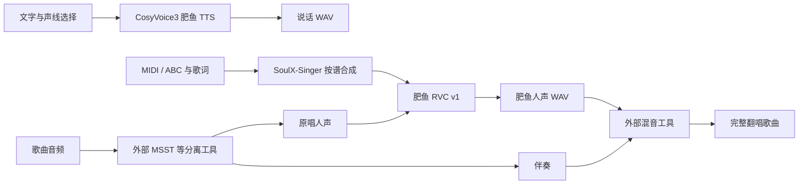

# 🐋 肥鱼声音 · 让小肥鱼开口说话，也能唱歌

一套可在本机部署的肥鱼声库与声音服务：**两条说话声线、RVC 换声、MIDI／ABC 按谱唱歌**，通过统一 HTTP 接口接到 AstrBot、DeepSeek／DSH 或其他 Bot。

想先了解能做什么，读这一页。让 AI 自己安装、自己调用，请把 [《小肥鱼的声音指南》](server/INSTALL_AGENT.md) 交给它。

## Run on Google Colab

无需安装本机 Python、WSL 或 CUDA，可以分别打开下面两份独立的推理 Notebook：

| 功能 | 入口 |
|---|---|
| FeiyuVoice RVC · 上传干净人声换色 |  |
| FeiyuVoice CosyVoice3 TTS · 可爱／温柔说话 |  |

1. 点击 Open in Colab，在 Runtime / Change runtime type 选择 GPU。
2. 按顺序运行初始化和模型下载单元格；第一次运行需要下载模型与依赖。
3. RVC 上传 WAV／MP3／FLAC 干净人声；TTS 选择声线并输入文本。
4. 运行推理，在 Notebook 中试听，再下载 WAV。

免费 GPU 不保证随时可用；型号、显存和会话时长由平台分配。**真实 Colab GPU 验收尚未完成**，请查看 [使用说明](colab/README.md) 和 [验证范围](colab/VALIDATION.md)。本入口只做交互式推理，不启动 WebUI 或公网服务。Colab [当前政策](https://research.google.com/colaboratory/faq.html)禁止 creating deepfakes；素材授权不自动等于平台批准，请核对用途，受限时使用获准的本地环境。

## 你想让小肥鱼做什么

| 你提供什么 | 小肥鱼可以做什么 | 需要的组件 |
|---|---|---|
| 一段文字 | 用偏可爱或偏温柔的声音说出来 | 肥鱼 TTS |
| 清唱或干净语音 WAV／FLAC | 保留演唱内容和旋律，换成肥鱼音色 | 肥鱼 RVC v1 |
| MIDI／ABC 主旋律＋歌词 | 按谱生成肥鱼人声演唱 | SoulX-Singer SVS＋肥鱼 RVC |
| 一首带伴奏的歌曲 | 分离人声与伴奏，翻唱，再混回伴奏 | 可供 agent 调用的 MSST 等分离工具＋RVC＋混音工具 |

最后一项由小肥鱼编排本地工具完成：本机已有 MSST 就复用；也可以让它安装 MSST 和所需的分离模型，再跑通整条流程。具体做法见指南的 [歌曲翻唱部分](server/INSTALL_AGENT.md#cover-song)。

## 先听懂这两条声线

| 声线 | 参数 | 听感定位 | 默认选择 |
|---|---|---|---|
| 可爱 | `cute` | 偏可爱，适合日常聊天、活泼回应 | **默认** |
| 温柔 | `gentle` | 偏温柔，适合轻声回应、安静陪伴 | 可按需切换 |

你可以直接告诉小肥鱼：“以后默认用温柔声线”，或“平时可爱一点，安慰我的时候用温柔声线”。agent 应记住你的偏好，在每次说话时传入相应的 `style`。两条声线是已提供的声音配置，不需要你重新录音才能试用。

想自己挑选，先让它把同一句话用两种声线各说一遍。

想先听一段唱歌 demo，也可以直接说：“给我唱一段《小星星》。”配置好唱歌组件后，具备文件生成和工具调用权限的小肥鱼，可以自己制作这类简单歌曲的 MIDI 谱子、配好对应歌词，再调用按谱唱歌接口。你不一定要先准备好谱子；复杂歌曲则需要合适的谱面或原曲素材。

## 最省心的安装方式：交给你的 agent

把下面这段话和仓库地址一起发给小肥鱼：

> 请先读这个项目的 README 和 `server/INSTALL_AGENT.md`，按《小肥鱼的声音指南》告诉我需要知道的信息，再为我安装肥鱼 TTS 和 RVC。优先使用 WSL，按显卡选择 CUDA 或 ROCm，复用已有可用环境。默认用可爱声线，安装后发两种声线的测试音频给我。需要翻唱时，检查本机 MSST 等工具；如果我让你补齐，就安装所需组件，完成分离、换声和混音，并说明哪些能力已经实测。

推荐 Windows＋WSL2 部署，推理环境放在 WSL 本地文件系统。NVIDIA 使用 CUDA；AMD 提供 WSL ROCm 预设，需核对具体显卡、驱动与支持组合，目前仍待实体 A 卡验收。

首次安装需要下载引擎、依赖和模型。语音合成、换声和已配置的歌曲处理在部署机器上执行；聊天模型、Bot 平台和消息发送使用各自的连接。

## DeepSeek、DSH、AstrBot 分别怎么接

| 你的宿主 | 接入方式 | 本仓提供什么 |
|---|---|---|
| AstrBot | 安装本仓插件，填写声音服务地址、API Key、声音 ID 和默认声线 | 命令、三个大模型工具、后台任务轮询和 WAV 返回 |
| DeepSeek／DSH 中的小肥鱼 | 由宿主的 HTTP／终端工具调用声音服务；需要时注册工具桥接 | 统一 HTTP 服务、调用流程与 agent 指南 |
| 其他 Bot／桌宠 | 按相同协议提交任务、取回音频，再调用平台的音频发送能力 | 与聊天平台分离的声音后端 |

DeepSeek／DSH 中的模型负责理解“说话、按谱唱歌、翻唱歌曲”等意图，本地声音引擎负责生成音频。DSH 接入与其客户端工具、播放器能力有关；本仓当前提供的是 AstrBot 插件和通用接口，DSH 的工具桥接及播放器需按实际宿主配置。

### AstrBot 用户

先部署独立声音服务，再从本仓安装插件；已有的 [v0.1.0 插件安装包](https://github.com/Esmerubphire/astrbot_plugin_feiyu_voice/releases/tag/v0.1.0) 也可使用。插件支持 AstrBot `>=4.29.3,<5`，服务当前为 `v0.2.0`，两者分别管理版本。

配置项：`base_url=http://127.0.0.1:9880`、`api_key`、`voice=feiyu`、`style=cute` 或 `gentle`、`caption_enable=true`。

`caption_enable` 打开时，模型可以在语音条后面紧跟一句短话（即 `feiyu_speak` 的 `caption` 参数，建议 20 字以内、口语化）：语音条单独发出，这条文字等音频发送成功后再补，顺序不受宿主消息链影响。模型不填 `caption` 时与旧版完全一致；关掉该开关则只发语音条。

| 命令 | 用法 |
|---|---|
| `/肥鱼状态` | 查看 TTS、换声和按谱唱歌的配置情况 |
| `/肥鱼说话 你好呀` | 按插件默认声线说话 |
| `/肥鱼换声`＋WAV／FLAC 附件 | 转换干净人声的音色 |
| `/肥鱼唱歌 歌词`＋MIDI／ABC 附件 | 按谱生成人声；先配置好可选 SVS 组件 |
| `/肥鱼任务 任务编号` | 查询或重新领取当前会话的音频 |

大模型工具为 `feiyu_speak(text, style, caption)`、`feiyu_convert(source="attachment")`、`feiyu_sing(lyrics)`。自然语言调用需要宿主配置可用的工具调用模型；命令调用可以独立使用。整首歌曲的分离和混音由具备本地工具权限的 agent 组织，插件当前的换声命令接收的是干净人声。

## 具体用了哪些技术

| 部分 | 技术与作用 |
|---|---|
| 说话 TTS | 基于 `Fun-CosyVoice3-0.5B-2512`，按 `cute`／`gentle` 路由各自的 checkpoint 与参考音频组合；当前输出 24 kHz 语音，运行时独立于 RVC |
| 人声换色 RVC | RVC v2、40 kHz、HiFi-GAN 声码器；ContentVec 提取 768 维内容特征，RMVPE 提取基频，FAISS 索引辅助匹配肥鱼音色 |
| 按谱唱歌 SVS | MIDI／ABC 解析主旋律与时值、中文歌词转音素，SoulX-Singer 先按谱演唱，随后由 RVC 转成肥鱼音色；交付 40 kHz 单声道人声 |
| 歌曲分离与混音 | MSST 等外部工具生成原唱人声和伴奏；agent 将人声交给 RVC，再用 FFmpeg 等工具对齐采样率、时间和音量后混音 |
| 声音服务 | FastAPI＋持久化任务记录＋串行推理队列；Bearer 鉴权、资源上传、异步任务、音频下载 |
| 显卡环境 | PyTorch CUDA／WSL ROCm／Intel XPU（Windows／Linux 原生）可选，各引擎独立环境；TTS ONNX 前端走 CPU，ROCm 预设的 RMVPE 也走 CPU，主网络走所选 GPU |

“乐谱＋歌词直接生成肥鱼人声”已经由按谱唱歌接口串联完成，内部同时需要 SVS 和 RVC。RVC 单独接收的是音频。按谱合成还需要安装 SVS 权重并配置自有已对齐参考；这些配置由 agent 按指南处理。

RVC 当前默认 `pitch_shift=0`、`index_rate=0.3`、`protect=0.33`，使用匹配索引；手动换气衰减是可选后处理，需要本曲标记区间。音域、咬字和表现仍受输入演唱与声库素材影响，具体效果需要试听。

## 有 MSST，小肥鱼怎样把一首歌翻唱完

1. **准备原曲**：小肥鱼检查本机分离工具、模型和可调用的 CLI／Python 入口。
2. **分离**：保存原唱人声和伴奏，核对音轨内容与时间起点。
3. **换声**：把原唱人声上传到肥鱼声音服务，调用 RVC，下载肥鱼人声。
4. **混音**：将肥鱼人声与伴奏按采样率、时间和音量对齐，输出完整歌曲。
5. **交付**：发回混音成品；需要时同时提供清唱和伴奏，方便继续调整。

本机没有 MSST 时，可以让小肥鱼依据 [MSST-WebUI 官方说明](https://github.com/SUC-DriverOld/MSST-WebUI) 单独部署并下载分离模型，先用短片段验证。**这条路线依靠 agent 调用外部工具；当前声音服务没有内置“一键分离＋混音”接口，也不随包安装 MSST。** 已有谱子和歌词、只需要生成人声时，可以直接走按谱合成路线。

## 模型从哪里下载

| 模型 | 下载地址 |
|---|---|
| 肥鱼 TTS：可爱＋温柔 | [Hugging Face](https://huggingface.co/Esmerubphire/FeiyuVoice-CosyVoice3) · [ModelScope](https://modelscope.cn/models/Esmerubphire/FeiyuVoice-CosyVoice3) |
| 肥鱼 RVC v1：模型＋匹配索引 | [Hugging Face](https://huggingface.co/Esmerubphire/FeiyuVoice-RVC) · [ModelScope](https://modelscope.cn/models/Esmerubphire/FeiyuVoice-RVC) |

本仓提供服务端、AstrBot 插件、环境预设与安装脚本；模型包另行下载。按谱唱歌的 SoulX-Singer 权重和已对齐参考、MSST 及分离模型属于各自的额外组件，按需要安装。

## 给自己部署的人：文档入口

| 你要做什么 | 从这里开始 |
|---|---|
| 让小肥鱼自己安装、选择声线、调用工具 | [小肥鱼的声音指南](server/INSTALL_AGENT.md) |
| 手动部署服务，了解全部接口 | [声音服务说明](server/README.md) |
| 查看后端预设与旧环境兼容说明 | [运行环境说明](server/RUNTIME.md) |
| 查看已通过的测试与验证范围 | [验证记录](server/VALIDATION.json) |
| 查看 AMD 适配与文档更新记录 | [CHANGELOG.md](CHANGELOG.md) |
| 查看分发条款与第三方许可 | [NOTICE.md](NOTICE.md) |

## 当前验证到哪一步

Windows＋WSL、RTX 5090 Laptop GPU 上完成 TTS、RVC 和按谱唱歌的真实 HTTP 验证；CUDA RVC 从空目录安装与换声验证通过。AstrBot 4.29.3 本地 WebChat 验证过命令与音频返回。

Intel XPU（Arc／Core Ultra 核显）以**显式选择的实验支持**接收，支持 Windows／Linux 原生运行，不经过 WSL；贡献者报告 Windows Arc 130T 已跑通 TTS、RVC 和按谱唱歌，Linux Arc A770M 已通过三种引擎诊断及 TTS／RVC 真实 HTTP 验证，Linux 按谱唱歌尚待额外权重与参考音频验收，维护者尚无 Intel 实机复验或新增听感验收，详见 [验证记录](server/VALIDATION.json)；AMD ROCm 目前提供适配和安装预设，尚无实体 A 卡测试；DSH 原生工具桥接、外部 Bot 平台以及各机器上的 MSST 整曲编排，需要在对应环境验收。按谱输入当前以中文单音主旋律为主，一字多音使用 `_`，ABC 反复记号先展开。硬件速度和显存占用以本机诊断、实际样例为准。

## 参考与许可

肥鱼声库的原始音频素材来自 B 站 UP 主 [**星落落_oi**](https://space.bilibili.com/30584746/)。**训练素材均已取得原 UP 主授权同意，用于本项目声库训练。** 感谢原作者的支持。素材来源与授权说明见 [COPYRIGHT.md](COPYRIGHT.md)。

文档组织参考了 [dsh-voice-stack](https://github.com/ParadoxFoehn/dsh-voice-stack/blob/main/README.md) 对工具与消息流程的介绍，以及 [Whale Voice](https://github.com/2177302423qqcom-byte/whale-voice) 的任务入口与 agent 指南分工。本文技术参数和验证结论来自肥鱼项目自身。

CosyVoice、Applio／RVC、SoulX-Singer、MSST 等组件遵循各自条款。本仓与肥鱼模型的分发说明见 [NOTICE.md](NOTICE.md)，各项目的许可分别适用。
